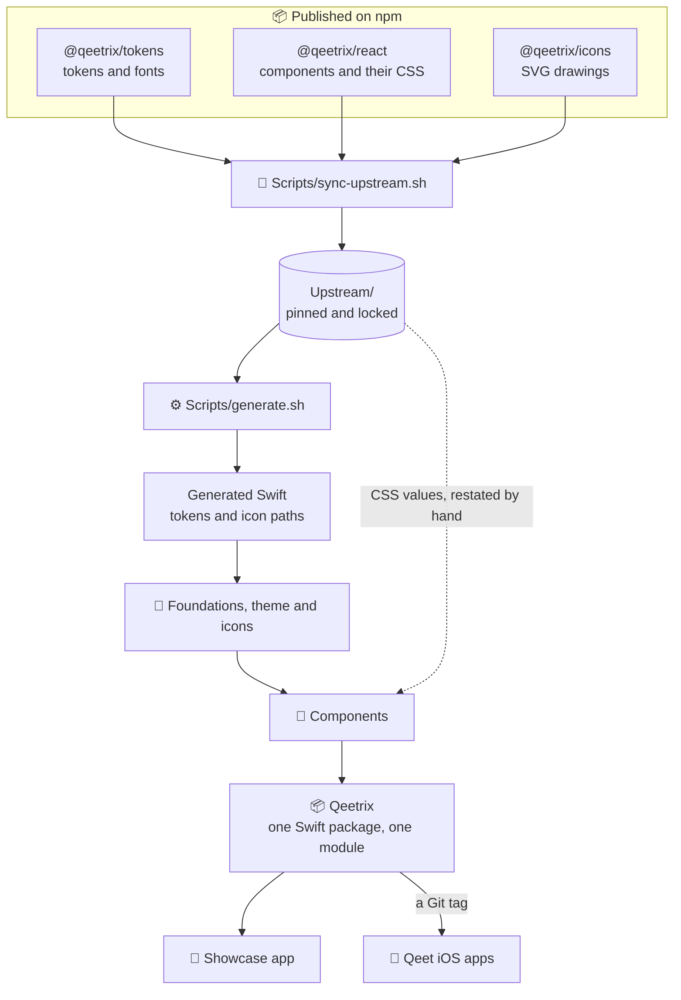
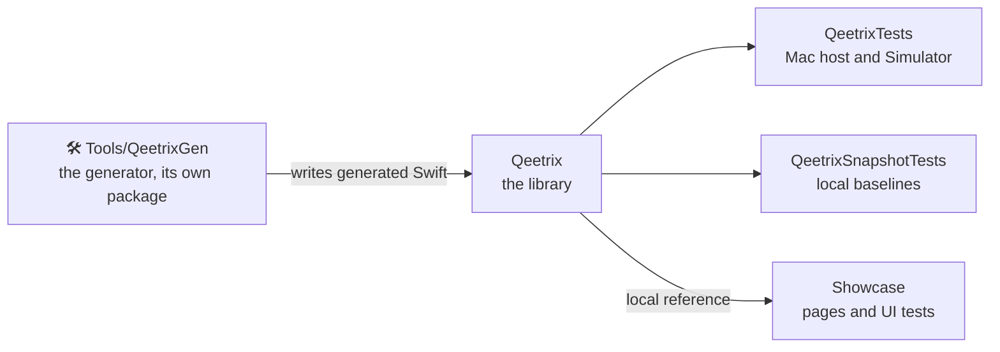
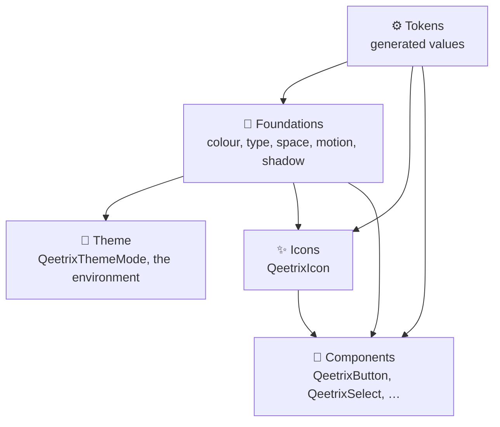

# 🏗️ Architecture

How Qeetrix for iOS turns the published Qeetrix packages into a SwiftUI package, and the rules that keep it that way.
The reasons behind each choice are in [docs/decisions.md](docs/decisions.md).

## 🗺️ The big picture

Nothing visual is decided here. Tokens, fonts, icons and component looks come from the web's npm packages. They are
synced, locked and turned into Swift, and the components are built on top.

## 🔄 From npm to Swift

| Step | Command | What it does |
|:--|:--|:--|
| **Sync** | `Scripts/sync-upstream.sh` | Fetches the three packages pinned in `Upstream/pins.json`, checks each against the npm registry's integrity hash, and records every file's sha256 in `Upstream/upstream.lock.json` |
| **Generate** | `Scripts/generate.sh` | Reads only `Upstream/` and writes the generated Swift and the reports (`docs/tokens.md`, `docs/token-values.json`). The same input always gives the same bytes. |
| **Verify** | `Scripts/verify.sh` | Part of every build: fails if a locked file changed or a generated file differs from a fresh generation |

**How the web's values map to iOS:** 1 px is 1 pt; text sizes scale with Dynamic Type from the web's sizes; colours are
converted from OKLCH by CSS Color 4, to sRGB or Display P3, and resolved per colour scheme from the environment.

## 📦 The package

- **One module, `Qeetrix`.** It depends on no other package and no Qeet product. Its only package dependency,
  swift-snapshot-testing, is test-only, so apps never resolve it.
- **`Sources/Qeetrix/`** holds `Tokens/`, `Foundations/`, `Theme/`, `Icons/`, `Components/<Family>/` (one folder per
  `@qeetrix/react` family), `Internal/`, the resources (fonts, licence texts, strings) and the DocC catalogue.

## 🧱 Inside the library

- **Tokens** hold values only. **Foundations** give them behaviour: `QeetrixColor` becomes a `ShapeStyle` that
  resolves light or dark, `QeetrixTextRole` gets a font that follows Dynamic Type, easings become `Animation`s.
- **Foundations and components read the SwiftUI environment** (`colorScheme`, `dynamicTypeSize`, `isEnabled`,
  `accessibilityReduceMotion`), never the Theme layer. Only apps use the Theme layer.
- **Generated code is the typed API's values:** a token added or removed upstream changes the public API, which
  `Scripts/api-check.sh` catches.

## 🧩 How a component is built

- **It wraps the system control** rather than imitating it: `TextField`, `SecureField`, `Toggle`, `Menu`,
  `ProgressView`. VoiceOver, Full Keyboard Access and AutoFill then work as iOS users expect.
- **Overlays are the system's presentations:** `.alert`, `.confirmationDialog`, `.sheet`, `.popover` and `Menu`,
  driven by a binding the app owns. There is no presentation manager, router or global state.
- **Styles work on native controls too:** `.buttonStyle(.qeetrix())`, `.toggleStyle(.qeetrixSwitch)`,
  `.progressViewStyle(.qeetrix())`.
- **Values come from the tokens and the family's CSS,** restated with the CSS rule beside each literal.
- **It ships complete:** tests, a snapshot test, a DocC page and a showcase page.

## ❓ Open design questions

Recorded for a design review, not decided here:

- **Sizes are the web's.** Body text is 14 pt, where iOS defaults to 17 pt. Controls keep the web's drawn size and
  extend their touch target to 44 pt.
- **The default density** is pointer-sized; only the comfortable density reaches 44 pt controls.
- **Bold Text** moves one weight step; **one toast at a time**, where the web stacks them.
- **System menus and alerts** keep the system's font and material.

## 🌉 Web and Android

- **The web is the authority.** Tokens, fonts and icons change only upstream and arrive here by a pin bump.
- **[qeetrix-android](https://github.com/qeetgroup/qeetrix-android)** pins the same packages and versions with the
  same rules; the shared rules are in [docs/llm/boundaries.md](docs/llm/boundaries.md).
