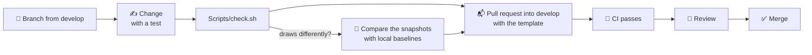
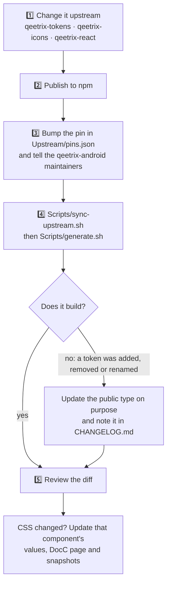
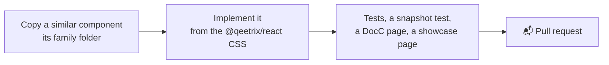
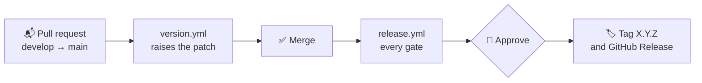

# 🤝 Contributing

Thanks for helping build Qeetrix for iOS. This page covers setting up, the commands, and the four things you are most
likely to do: change something, change how something looks, add a component, and release.

## 🛠️ Setting up

- **Xcode 27.1** (Swift 6.4), with an iOS Simulator runtime. CI uses the same Xcode.
- **No other tools.** The generator is a Swift package in `Tools/QeetrixGen`, and `swift-format` ships with Xcode.
- **Network**, only for resolving the test-only package and for `Scripts/sync-upstream.sh`.

Open `Package.swift` in Xcode, or check that everything works from the command line:

```sh
Scripts/check.sh
```

## 🔁 Making a change



- **Pull requests go into `develop`.** Only `develop` goes into `main`, through a `develop` → `main` pull request the
  maintainer opens; `main` refuses anything else.
- **One topic per pull request.** Fill in the template's checklist.
- **A source-breaking API change** fails CI (`Scripts/api-compat.sh`). Make it additive and deprecate the old name,
  or raise the major version in `VERSION` (the minor while 0.x).
- **Mirror cross-platform changes** (naming, colour conversion, token scope) in qeetrix-android, or record the
  difference in [docs/llm/boundaries.md](docs/llm/boundaries.md).

## ⌨️ Commands

**Every day**

| Command | What it does |
|:--|:--|
| `Scripts/check.sh` | Every Mac-host gate: the generator's tests, upstream lock and drift, `swift-format`, compiler warnings, dependencies, resources, the library's tests |
| `swift test` | The library's tests on the Mac host |
| `Scripts/lint.sh` | `swift-format`, strict |
| `xcodebuild test -scheme Qeetrix -destination "platform=iOS Simulator,id=$(Scripts/ci-simulator.sh)"` | The library's tests on the iOS Simulator |

**Snapshots, API and docs**

| Command | What it does |
|:--|:--|
| `TEST_RUNNER_SNAPSHOT_TESTING_RECORD=all xcodebuild test -scheme Qeetrix -only-testing:QeetrixSnapshotTests -destination …` | Record the snapshot baselines on a commit you trust. They stay on your machine. |
| `xcodebuild test -scheme Qeetrix -only-testing:QeetrixSnapshotTests -destination …` | Compare your change with them |
| `Scripts/api-compat.sh origin/main` | No source-breaking change against `main` |
| `Scripts/docs.sh` | The DocC documentation, warnings as errors |

**The showcase and releases**

| Command | What it does |
|:--|:--|
| `xcodebuild test -project Showcase/QeetrixShowcase.xcodeproj -scheme QeetrixShowcase -destination …` | The UI tests and Apple's accessibility audit over every showcase page (about an hour). Not run in CI: run them before a change to a component's interaction. |
| `Scripts/release-check.sh <version> [--allow-dirty]` | Every release gate, with evidence in `.build/release-evidence` |
| `Scripts/sbom.sh <version> [file]` | The release's CycloneDX bill of materials |

**Upstream**

| Command | What it does |
|:--|:--|
| `Scripts/sync-upstream.sh [--check]` | Fetch and verify the pinned npm packages (network) |
| `Scripts/generate.sh` | Regenerate everything made from `Upstream/` |
| `Scripts/verify.sh` | Only the lock and drift check |

## 🎨 Changing how something looks

A colour, size, font, icon or component look is never changed here. It changes on the web first, then reaches iOS
through a pin bump:



**Never edit `Upstream/`, a `Generated/` folder, `docs/tokens.md` or `docs/token-values.json` by hand.**
`Scripts/verify.sh` fails if you do.

## 🧩 Adding a component



A component lives in `Sources/Qeetrix/Components/<Family>/`, named after its `@qeetrix/react` family. Wrap the system
control or presentation rather than imitating it, keep state in a binding the app owns, give it a 44 pt touch target
and full VoiceOver support, and add its row to [docs/components.md](docs/components.md).

## 🚀 Releasing

Like every Qeetrix package, **merging to `main` releases the version in `VERSION`**. A Swift package is published by its
Git tag, so releasing means tagging a verified commit:



- **The version is in the pull request's diff.** `version.yml` raises the patch when the library changes; raise the
  minor or major by hand. Docs, tests and CI changes need no new version.
- **The CHANGELOG entry** (`## [X.Y.Z] — YYYY-MM-DD`) becomes the GitHub Release's notes.
- **A bad release** is marked withdrawn with **Actions › Rollback**, and the fix is a new version.

Details: [docs/releases.md](docs/releases.md).

## ✍️ Code

- **Swift 6, strict concurrency,** and **no compiler warnings** (`Scripts/warnings.sh`).
- **`swift-format`**, strict (`Scripts/lint.sh`).
- **Every public declaration documented** in DocC, which CI builds with warnings as errors.
- **No literal colours, durations or fonts.** Use the tokens. A size the tokens don't name comes from the component's
  CSS, with the CSS beside it.
- **No new runtime dependency.** A test-only one needs its entry in `Tools/dependency-allowlist.json`.

## 🧪 Tests

- **New behaviour comes with a test that would fail without it.** Check values against an independent source, never a
  constant against itself.
- **Swift Testing** for the library (`Tests/QeetrixTests`), on the Mac host and the iOS Simulator.
- **Snapshots stay on your machine.** They aren't committed and CI doesn't compare them. If your change alters how a
  component draws, compare with baselines recorded before it, and describe the change in the pull request.
- **UI tests** in the showcase drive presentation, focus and VoiceOver, and run Apple's accessibility audit.

## ♿ Accessibility

Every change keeps VoiceOver labels and order, 44 pt touch targets, contrast in both schemes, Dynamic Type to the
largest size, right to left and Reduce Motion. The tests and the accessibility audit check most of these
automatically; VoiceOver use by a person still needs a device ([docs/quality.md](docs/quality.md)).
