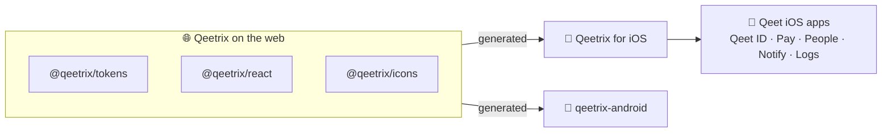

<div align="center">

# 🍎 Qeetrix for iOS

**Qeet Group's design system for SwiftUI: the Qeetrix look of the web and Android, as native iOS components.**

[](https://github.com/qeetgroup/qeetrix-ios/releases/latest)
[](https://github.com/qeetgroup/qeetrix-ios/actions/workflows/ci.yml)
[](#-quick-start)
[](#-quick-start)
[](#-quick-start)
[](LICENSE)

[🌐 ui.qeet.in](https://ui.qeet.in) · [🚀 Quick start](#-quick-start) · [🧩 Components](docs/components.md) · [🏗️ Architecture](ARCHITECTURE.md) · [📝 Changelog](CHANGELOG.md)

</div>

## 📦 What's inside

| | |
|:--|:--|
| 🧩 **57 component families** | Buttons, forms, sheets, menus, navigation and lists, plus native ones: the OTP code, QR scanner, swipe actions and pull to refresh |
| 🎨 **Foundations** | 109 colour roles in light and dark, 18 text roles with Dynamic Type, spacing, radii, shadows, motion and three densities |
| ✨ **1,863 icons** | Every `@qeetrix/icons` icon, sharp and round, outline and filled; the components' 100 in `Qeetrix`, the rest in the optional `QeetrixIconsExtended` |
| 🔤 **Fonts** | Qeet Sans and Fira Code, the same files the web uses, registered from the package |
| ♿ **Accessible** | VoiceOver labels, 44 pt targets, checked contrast, Dynamic Type to the largest size, Reduce Motion |
| 📚 **Documented** | A DocC catalogue: **Product › Build Documentation** in Xcode |

## 🔗 How it fits

The web's packages are the single source of truth: tokens, fonts and icons are generated from them, never copied by
hand, so a colour or a size is the same on every platform.



## 🚀 Quick start

iOS 17 or later, Swift 6 (Xcode 27.1). In Xcode, **File › Add Package Dependencies…** with this repository's URL, or
in `Package.swift`:

```swift
// Before 1.0 a minor version may break source, so take patches only.
.package(url: "https://github.com/qeetgroup/qeetrix-ios.git", .upToNextMinor(from: "0.3.0"))
```

Add the `Qeetrix` product to your target, set the theme once at the root, and build from the components:

```swift
import Qeetrix
import SwiftUI

struct RootView: View {
    // The same key and values as the web's stored theme preference.
    @AppStorage("theme") private var mode: QeetrixThemeMode = .system

    var body: some View {
        HStack(spacing: QeetrixSpace.gapSm) {
            QeetrixButton("Create invoice") { create() }
            QeetrixButton("Export", icon: .share2, variant: .soft) { export() }
        }
        .qeetrixThemeMode(mode)
    }
}
```

Where SwiftUI has a style protocol, Qeetrix styles native controls too: `.buttonStyle(.qeetrix())`,
`.toggleStyle(.qeetrixSwitch)`. Every component, with its API and its `@qeetrix/react` counterpart, is in
[docs/components.md](docs/components.md).

## 🛠️ Develop

```sh
Scripts/check.sh      # every Mac gate: generator, upstream lock, format, warnings, dependencies, tests
Scripts/docs.sh       # the DocC documentation, warnings as errors
```

The `Showcase` app shows every foundation and component in both themes and at any text size: open
`Showcase/QeetrixShowcase.xcodeproj` and run it on a simulator. Before every push, run the whole local gate (the Mac
and iOS Simulator tests, DocC and source compatibility): [CONTRIBUTING.md](CONTRIBUTING.md), "Before you push".

## 🚢 Releases

Work lands on `develop`. A pull request from `develop` into `main` with `VERSION` raised and a dated
[changelog](CHANGELOG.md) entry releases it: merging tags `X.Y.Z` and opens a GitHub Release with the bill of
materials. Swift Package Manager resolves the tag.

## 📚 Learn more

| | |
|:--|:--|
| 🏗️ [Architecture](ARCHITECTURE.md) | How the package is generated and built |
| 🤝 [Contributing](CONTRIBUTING.md) | Setting up, the commands, adding a component, releasing |
| 🔒 [Security](SECURITY.md) | What the package touches, and how to report a vulnerability |
| 🤖 [qeetrix-android](https://github.com/qeetgroup/qeetrix-android) | The same design system for Jetpack Compose |

## 📜 Licence

[MIT](LICENSE) © 2026 Qeet Group. The bundled fonts and icons keep their own licences ([third party](docs/third-party.md)).
