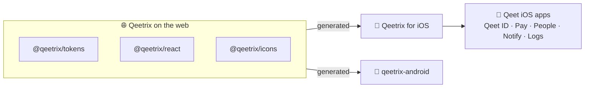

<div align="center">

# 🎨 Qeetrix for iOS

**Qeet Group's design system for SwiftUI: the Qeetrix look of the web and Android, as native iOS components.**

[](#-getting-started)
[](#-getting-started)
[](#-getting-started)
[](#-getting-started)
[](Upstream/pins.json)
[](LICENSE)
[](#-status)

[📖 Design system](https://ui.qeet.in) · [🧩 Components](docs/components.md) · [🏗️ Architecture](ARCHITECTURE.md) · [📝 Changelog](CHANGELOG.md)

</div>

## 📦 What's inside

| | |
|:--|:--|
| 🧩 **71 components** | Buttons, forms, sheets, menus, navigation and lists, plus native-only ones such as the OTP code, QR scanner, swipe actions and pull to refresh |
| 🎨 **Foundations** | 109 colour roles in light and dark, 18 text roles with Dynamic Type, spacing, radii, shadows, motion and three densities |
| ✨ **68 icons** | From `@qeetrix/icons`, sharp and round, outline and filled, mirrored in right to left by meaning |
| 🔤 **Fonts** | Qeet Sans and Fira Code, the same files the web uses, registered from the package |
| ♿ **Accessibility** | VoiceOver labels, 44 pt touch targets, checked contrast, Dynamic Type to the largest size, Reduce Motion |
| 📚 **Documentation** | A DocC catalogue: **Product › Build Documentation** in Xcode, or `Scripts/docs.sh` |

## 🔗 How it fits

The web's packages are the single source of truth. Tokens, fonts and icons are generated from them, never copied by
hand, so a colour or a size is the same on every platform.



## 📍 Status

| Version | State |
|:--|:--|
| `0.1.0-rc.1` | A release candidate, before the `@qeetrix/react` migration. Not released. |
| `0.1.0` | ✅ Released on 4 November 2026 ([release](https://github.com/qeetgroup/qeetrix-ios/releases/tag/0.1.0)) |

## 🚀 Getting started

**Requirements:** iOS 17 or later, and Swift 6 (Xcode 27.1).

**Install** with Swift Package Manager. In Xcode, choose **File › Add Package Dependencies…** and enter the repository
URL, or add it to `Package.swift`:

```swift
// Before 1.0 a minor version may break source, so take patches only.
.package(url: "https://github.com/qeetgroup/qeetrix-ios.git", .upToNextMinor(from: "0.1.0"))
```

Then add the `Qeetrix` product to your target. Nothing else is needed: no account, token, Node.js or generator.

**Use.** Set the theme once at the root, then build screens from the components:

```swift
import Qeetrix
import SwiftUI

@main
struct MyApp: App {
    var body: some Scene {
        WindowGroup { RootView() }
    }
}

struct RootView: View {
    // Same key and values as the web ThemeProvider's stored preference. Read in a view, so a change
    // redraws the window: a WindowGroup's content isn't rebuilt when the App's own state changes.
    @AppStorage("theme") private var mode: QeetrixThemeMode = .system

    var body: some View {
        ContentView().qeetrixThemeMode(mode)
    }
}

struct InvoiceActions: View {
    var body: some View {
        HStack(spacing: QeetrixSpace.gapSm) {
            QeetrixButton("Create invoice") { create() }
            QeetrixButton("Export", icon: .share2, variant: .soft) { export() }
        }
    }
}
```

## 🧩 Components

| Group | Components |
|:--|:--|
| 👆 **Actions** | `QeetrixButton` · `QeetrixIconButton` · `QeetrixCopyButton` · `QeetrixSegmentedControl` · bottom action bar |
| ✍️ **Forms** | `QeetrixTextField` · `QeetrixPasswordInput` · `QeetrixSelect` · `QeetrixCombobox` · `QeetrixCheckbox` · `QeetrixRadioGroup` · `QeetrixSwitch` · `QeetrixSlider` · `QeetrixOTPInput` · `QeetrixDatePicker` |
| 📊 **Data display** | `QeetrixListItem` · `QeetrixAvatar` · `QeetrixBadge` · `QeetrixChip` · `QeetrixStat` · `QeetrixTimeline` · `QeetrixQRCode` · `QeetrixOTPCode` |
| 💬 **Feedback** | `QeetrixAlert` · `QeetrixProgress` · `QeetrixSpinner` · `QeetrixSkeleton` · `QeetrixToast` · `QeetrixEmptyState` |
| 🪟 **Overlays** | Alert and confirmation dialogs · sheets · popovers · `QeetrixMenu` · `QeetrixFullScreenForm` |
| 🧭 **Navigation** | `QeetrixTabs` · `QeetrixSteps` · `QeetrixSidebar` · `QeetrixPageIndicator` · navigation and tab bar styles |
| 📐 **Layout** | `QeetrixCard` · `QeetrixAccordion` · `QeetrixSeparator` |

Where SwiftUI has a style protocol, the style works on native controls too: `.buttonStyle(.qeetrix())`,
`.toggleStyle(.qeetrixSwitch)`, `.progressViewStyle(.qeetrix())`. The full list is in
[docs/components.md](docs/components.md).

## 📲 Showcase app

`Showcase` shows every foundation and component in both themes and at any text size. Open
`QeetrixShowcase.xcodeproj` and run it on a simulator; launch it with `-page switch` to open one page directly.

## 🔨 Building

```sh
Scripts/check.sh      # every gate that runs on the Mac: generator, drift, format, warnings, tests, public API
Scripts/docs.sh       # the DocC documentation, warnings as errors
```

The iOS Simulator tests and every other command are in [CONTRIBUTING.md](CONTRIBUTING.md).

## 📚 Learn more

| | |
|:--|:--|
| 📖 [ui.qeet.in](https://ui.qeet.in) | The Qeetrix design system |
| 🧩 [Components](docs/components.md) | Every component, its API and its `@qeetrix/react` counterpart |
| 🏗️ [Architecture](ARCHITECTURE.md) | How the package is generated and built |
| 🤝 [Contributing](CONTRIBUTING.md) | Setting up, commands, adding a component, releasing |
| 📝 [Changelog](CHANGELOG.md) | What's in each version |
| 🔒 [Security](SECURITY.md) | What the package touches, and how to report a vulnerability |

## 📜 Licence

[MIT](LICENSE) © 2026 Qeet Group, as the web's `@qeetrix/*` packages and qeetrix-android are. The bundled fonts and
icons keep their own licences ([third party](docs/third-party.md)).

---

<div align="center">

Made with 🧡 by Qeet Group · [⬆️ Back to top](#-qeetrix-for-ios)

</div>
