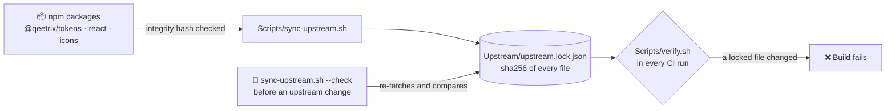

# 🔒 Security

Qeetrix for iOS is a UI package. It draws what the app gives it, and nothing more.

| | |
|:--|:--|
| 🌐 **Network** | None. It makes no requests and loads no remote images. |
| 🔑 **Permissions** | None of its own. The QR scanner uses the camera only through the app's own permission and `Info.plist` entry. |
| 💾 **Data** | Nothing stored, logged or sent. What a person types stays in the binding the app owns. |
| 🛡️ **Privacy manifest** | Not needed: the package uses none of Apple's required-reason APIs, which the release gates check |
| 📦 **Ships with** | No runtime dependencies. Two font files, licence texts, built-in strings and a token provenance record, loaded from the package bundle. |

## 🛡️ Supply chain

Everything the package is built from is pinned, checked and locked:

- **Upstream packages** are pinned by version in `Upstream/pins.json`. Each bundled font must also match the checksum
  `@qeetrix/tokens` publishes for it.
- **Test-only dependencies** (swift-snapshot-testing and what it brings) are pinned in `Package.resolved`, reviewed
  in `Tools/dependency-allowlist.json` and checked by `Scripts/dependencies.sh`. Apps never resolve them.
- **GitHub Actions** are pinned to full commit SHAs, with the narrowest permissions per job.

## 🔐 Sensitive input and content

- **Passwords and one-time codes.** `QeetrixPasswordInput` is a `SecureField`; neither it nor `QeetrixOTPInput` puts the
  text in any label or accessibility value. AutoFill works through the content types they set.
- **Toasts, alerts and dialogs** are shown on screen and read aloud. Never put a password, code or other secret in
  them. A confirmation dialog records a choice and authorises nothing: the code that acts must check permission.

## 🚢 Releases

- **A release is a Git tag** on a commit that passed every gate, created by `release.yml` only after an approver
  approves it. Tags are never moved or deleted.
- **Each release carries a CycloneDX bill of materials** built from the pins, the lock and `Package.resolved`.

## 📅 Supported versions

| Version | Security fixes |
|:--|:--|
| `main` | ✅ Yes |
| `0.1.x` | ✅ Yes, as a patch of the latest minor version ([docs/releases.md](docs/releases.md)) |

## 🚨 Reporting a vulnerability

**Don't report a vulnerability in an issue or a pull request:** anyone can read those.

1. Open the repository's **Security** tab and choose **Report a vulnerability**. Only the maintainers see the report.
2. Say what you found and its impact.
3. Explain how to reproduce it.
4. Name the version or commit you tested.

The maintainers reply in the private advisory, and publish it with the fix.
