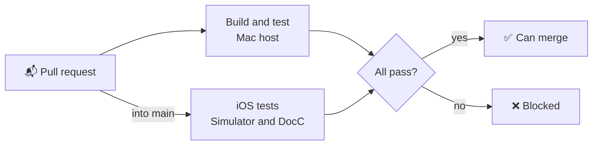

# 🔍 Quality

How Qeetrix for iOS is checked, what it promises about its API, and what is still open. Current for `0.1.0`
(4 November 2026).

## ✅ Checked automatically

| Check | Where | What it proves |
|:--|:--|:--|
| 🧪 **Behaviour and semantics** | Swift Testing, on the Mac host and the iOS Simulator | Each component's states, its VoiceOver labels, values and traits, and its layout at every Dynamic Type size |
| ♿ **Apple's accessibility audit** | `AccessibilityAuditUITests` in the showcase, run in Xcode | Every showcase page in light, dark and the largest text size, failing on any issue it doesn't exclude with a reason |
| 🧭 **Interaction** | 109 showcase UI tests, run in Xcode | Taps, typing, focus, presentation and dismissal, as a person would use them |
| 🌗 **Contrast** | `AccessibilityTests` | Every colour pair a component draws meets WCAG AA, in both schemes |
| 🔠 **Large text and right to left** | `LargeTextTests`, layout tests | Text wraps rather than being cut at the accessibility sizes; layouts mirror |
| 📸 **Snapshots** | swift-snapshot-testing, on a maintainer's machine | Every component in light, dark, the largest size and right to left matches its reviewed image |
| 🔌 **Public API** | `Scripts/api-compat.sh` | No source-breaking change against the target branch, unless the version allows it |
| 🧹 **Code** | `Scripts/lint.sh`, `Scripts/warnings.sh` | `swift-format` strict, and no compiler warnings |
| 📚 **Documentation** | `Scripts/docs.sh` | DocC builds with warnings as errors: every public symbol documented, no broken link |
| 🔒 **Supply chain** | `Scripts/verify.sh`, `Scripts/dependencies.sh` | Upstream files match their lock; test-only dependencies are reviewed and licensed |

## 🔌 API compatibility

| Kind | Breaks when | Caught by |
|:--|:--|:--|
| **Source** | A name, a parameter or an initialiser changes, so an app's code no longer compiles | `swift package diagnose-api-breaking-changes`, against the target branch or the last tag |
| **Behavioural** | A component does or draws something different | Behaviour tests, snapshots and UI tests. Listed under **Changed** in the CHANGELOG. |
| **Platform** | The deployment target or the Swift version an app needs rises | A minor release before 1.0, a major after |

- **Adding an icon is not breaking:** `QeetrixIconName` is an open set, so apps switch over it with a `default` case.
- **Extended icons cost only what an app names:** `Scripts/icon-budget.sh` (in `Scripts/check.sh`) builds a program
  with none and with twenty, and fails if the linker keeps any other icon or the twenty grow it past 4 KiB each.
- **A deliberate break** needs a new major version (a new minor while 0.x): raise it in `VERSION`, and list the
  break in the CHANGELOG.

## 🚧 Known gaps

Verification not done for `0.1.0`. None is a known defect.

| # | Gap | Status |
|:--|:--|:--|
| G1 | **VoiceOver, Full Keyboard Access and Switch Control, by a person** | Checked through semantics in tests and UI tests, not by a person on a device |
| G2 | **Physical devices** | Simulators only |
| G3 | **The iOS 17 runtime** | The deployment target is iOS 17. It compiles against it, but only newer simulator runtimes have been run. |
| G4 | **iPad** | Regular width was checked through an iPhone in landscape; sheets, popovers and columns behave differently on iPad |
| G5 | **Performance on a device** | The rendering-performance tests run on the Mac host and the Simulator |
| G6 | **Translations** | The built-in strings are English only |
| G7 | **Increased Contrast** | `@qeetrix/tokens` has no high-contrast colours yet, so Increased Contrast changes nothing |

## ✔️ Accepted by design

Recorded for a design review in [ARCHITECTURE.md](../ARCHITECTURE.md#-open-design-questions):

- **Sizes are the web's:** body text is 14 pt where iOS defaults to 17 pt. Controls keep the web's drawn size and extend
  their touch target to 44 pt.
- **System menus, alerts and confirmation dialogs** keep the system's font and material.
- **Bold Text** moves one weight step; **one toast at a time**, where the web stacks them.
