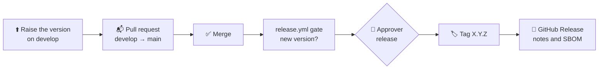

# 🚀 Releases

How versions are numbered, how a release is tagged, how apps install it, and what to do when one is bad.

## 🔢 Versions

[Semantic Versioning](https://semver.org): `MAJOR.MINOR.PATCH`, with release candidates `-rc.N`. Tags follow Swift's
convention, the bare version (`0.1.0`), with no `v`.

| Release | May change |
|:--|:--|
| Patch `x.y.Z` | Fixes only. No public API change. |
| Minor `x.Y.0` | Additions. **Before 1.0**, also source-breaking changes, each under **Breaking** in the CHANGELOG with migration steps. |
| Major `X.0.0` | From 1.0: breaking changes, after a deprecation in an earlier minor release |
| Candidate `-rc.N` | A trial of the version before the suffix, marked as a pre-release |

Before 1.0 apps take patches only (`.upToNextMinor(from:)`). **1.0** comes once a Qeet app has shipped with the
package.

## 🔁 How a release works

A Swift package is published by its Git tag: Swift Package Manager resolves the tag straight from this repository. So
a release is a verified commit, tagged:



1. **Raise the version, then the pull request into `main`.** When a change ships (`Sources/`, `Package.swift`,
   `Upstream/`), raise `VERSION` on develop: the next patch, or a minor or major. The pull request's Release gate fails
   until it's raised. Date the CHANGELOG entry
   (`## [X.Y.Z] — YYYY-MM-DD`): it becomes the release notes. A docs, tests or CI change needs no new version.
2. **Merge.** `release.yml` checks the version isn't tagged yet, that the `release` environment has a required
   reviewer, and that the CHANGELOG has the entry, then builds the bill of materials. It runs no checks: Verify passed
   on the pull request, and the tests, the iOS Simulator's included, ran locally before the push.
3. **Approve.** The publish job waits: **Actions › Release › Review deployments › Approve**.
4. **Tag and release.** It tags the verified commit `X.Y.Z` and opens a GitHub Release with the CHANGELOG entry and the
   CycloneDX bill of materials. A `-rc.N` version is marked as a pre-release.

Re-running is safe: a version that is already tagged is never released again. For a full local rehearsal with
evidence, run `Scripts/release-check.sh <version>`.

## 📥 Installing

In Xcode, choose **File › Add Package Dependencies…** and enter `https://github.com/qeetgroup/qeetrix-ios.git`, or add
it to `Package.swift`:

```swift
// Before 1.0 a minor version may break source, so take patches only.
.package(url: "https://github.com/qeetgroup/qeetrix-ios.git", .upToNextMinor(from: "0.1.0"))
```

Then add the `Qeetrix` product to your target. Nothing else is needed at build time: no account, token, Node.js, web
packages or generator. The optional `QeetrixIconsExtended` product, in the same package and so always the same version,
adds every other `@qeetrix/icons` icon ([icons.md](icons.md)).

## ↩️ When a release is bad

A tag is never moved or deleted: apps resolve tags, and their `Package.resolved` pins one.

1. **Stop new adoption.** Run **Actions › Rollback** (`rollback.yml`) with the good and the bad version. After
   approval, it makes the good version GitHub's latest release and marks the bad one withdrawn. Tell the app teams.
2. **Apps go back** by pinning the good version and resolving again.
3. **Fix forward** with a new patch release, and record it in the CHANGELOG.

## 🧩 Compatibility

| An app needs | Why |
|:--|:--|
| **iOS 17** or later | The package's deployment target |
| **Swift 6** (Xcode 27.1 or later) | The package's tools version and strict concurrency |

`Package.swift` also declares macOS 14, only so `swift build` and `swift test` run on a Mac during development. macOS
is not a supported product platform.

## 📦 What's in the package

- **Sources and resources:** the `Qeetrix` module, two fonts, their licence texts and the icons' notice, the built-in
  strings, and a token provenance record. **No runtime dependencies.**
- **No privacy manifest needed:** the package uses none of Apple's required-reason APIs, and the release gates check
  that it stays so.
- **Licences:** the bundled fonts are SIL OFL 1.1 and the icons MIT, with Lucide's ISC notice
  ([third-party.md](third-party.md)). The package's own code is [MIT](../LICENSE).

## 📝 0.1.0

The first version, released on 4 November 2026 as the tag `0.1.0`. Its known gaps are in [quality.md](quality.md#-known-gaps).

| Candidate | Built | Result |
|:--|:--|:--|
| `0.1.0-rc.1` | 20 October 2026, on `@qeetrix/ui` | Every gate passed. Superseded by the migration; never released. |
